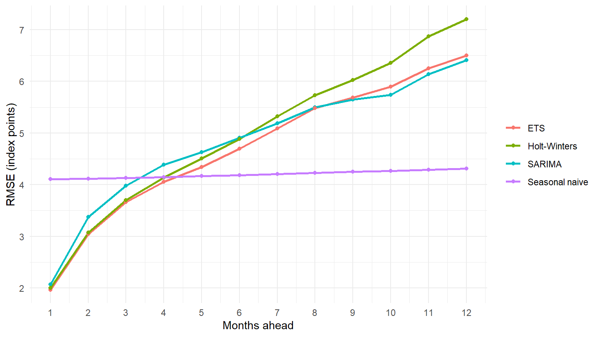

# Forecasting US Industrial Production

Monthly forecasts of the US Industrial Production Index (1990–2025) with
SARIMA, exponential smoothing and a VAR with University of Michigan consumer
sentiment, evaluated with a rolling-origin backtest. Written in R and
published as a Quarto website.

**Live report:** https://xwmara.github.io/us-industrial-production-forecast/



## Key findings

- **No model clearly wins.** In a rolling-origin backtest (models re-estimated
  every month from June 2016 to March 2025), SARIMA, ETS and Holt-Winters are
  statistically tied one month ahead (RMSE about 2.0 index points) and all
  significantly beat a seasonal naive benchmark (4.1). From about four months
  ahead the seasonal naive forecast has a lower RMSE, but the difference is not
  statistically significant.
- **A single forecast origin is misleading.** Evaluated from one origin only,
  SARIMA looked far better than ETS and Holt-Winters; the backtest does not
  confirm it.
- **Consumer sentiment is a significant but weak predictor.** It
  Granger-causes industrial production (p = 0.003) and explains about 5% of its
  forecast variance, but adding it to the model does not improve
  out-of-sample forecasts (neither the Diebold-Mariano test nor the
  Clark-West test for nested models finds a gain).
- **Outlook:** around 100–102 index points through April 2028 (95% interval
  84–120).

## What the analysis covers

| Area | Methods |
|---|---|
| Data preparation | log transformation, regular and seasonal differencing, train/test split |
| Statistical testing | KPSS, ADF, Phillips-Perron, HEGY, Ljung-Box, Jarque-Bera, ARCH |
| Univariate models | ARMA, SARIMA, ETS, Holt-Winters, seasonal naive benchmark |
| Forecast evaluation | single-origin and rolling-origin (expanding window) backtests, RMSE / MAE / MAPE, Diebold-Mariano tests, robustness check without the pandemic |
| Multivariate models | Johansen cointegration test, VAR with seasonal dummies, Granger causality, impulse responses, variance decomposition, out-of-sample value of sentiment (Diebold-Mariano and Clark-West tests) |

## From course project to portfolio

The project started as a team assignment for a Time Series course. For this
version the analysis was rebuilt for reproducibility and reviewed. The main
corrections:

- the forecast comparison relied on one forecast origin and a Diebold-Mariano
  test that treated 1- to 106-step errors as independent; it is now a
  rolling-origin backtest with tests at the matching horizon;
- future forecasts came from a model trained only up to 2016; they now come
  from a model re-estimated on all data;
- the VAR ignored seasonality and had autocorrelated residuals; seasonal
  dummies and a residual-based lag choice changed the Granger result;
- the log back-transformation, the HEGY test specification and the
  impulse-response ordering were corrected or checked for robustness.

Before any correction, the code was checked to reproduce the original results
exactly.

## Repository structure

```
├── index.qmd            # overview: findings, outlook, limitations
├── univariate.qmd       # stationarity, ARMA/SARIMA/ETS/Holt-Winters, backtest
├── multivariate.qmd     # consumer sentiment, cointegration, VAR
├── R/
│   ├── setup.R          # shared packages and data loading
│   └── get_data.R       # downloads the data (fixed ALFRED vintage)
├── data/                # industrial production CSV and data notes
├── results/             # key results saved by the analysis pages, read by index.qmd
├── _freeze/             # stored computation results used to build the site
├── _quarto.yml          # website configuration
└── renv.lock            # exact R package versions
```

## Reproduce

Requirements: R (4.5) and [Quarto](https://quarto.org/).

```bash
Rscript -e "renv::restore()"   # install the package versions in renv.lock
Rscript R/get_data.R           # download the data (consumer sentiment is not stored in the repo)
quarto render                  # build the website into _site/
```

Thanks to Quarto's `freeze`, the site can be rebuilt without re-running the
analysis; delete `_freeze/` to recompute everything.

## Data

| Series | Source | Terms |
|---|---|---|
| IPB50001N, Industrial Production: Total Index | Board of Governors of the Federal Reserve System, via FRED | Public domain, citation requested; included in `data/` |
| UMCSENT, University of Michigan: Consumer Sentiment | Surveys of Consumers, University of Michigan, via FRED | Copyrighted, citation required; downloaded locally, not redistributed |

Both series are retrieved from ALFRED with the vintage of 17 December 2025.
Full citations are in [data/README.md](data/README.md). This project is not
endorsed by the Federal Reserve Bank of St. Louis, the Federal Reserve Board or
the University of Michigan.

## Credits

Portfolio adaptation by **Mara Livia Popa**.

Based on a team course project for the Time Series course at the Bucharest
University of Economic Studies (Faculty of Cybernetics, Statistics and
Economic Informatics, 2025) with Ionela Popa, Luca Stancu and Stanislav
Porcesco, supervised by Eduard Mihai Manta.

## License

The code is released under the [MIT License](LICENSE). The data keep their
original terms of use (see [Data](#data)).
